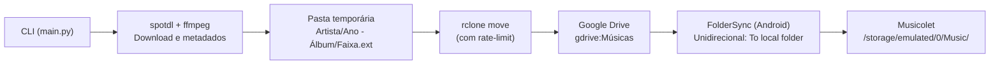

# Music Fetcher

Ferramenta CLI em Python (compatível com **Arch Linux** e **Windows**) para baixar, organizar com metadados e sincronizar uma biblioteca musical offline (~29,3 GiB / ~3.292 faixas) entre o PC, o **Google Drive** e um smartphone **Android** (**FolderSync** + **Musicolet**).

---

## Arquitetura do Fluxo



1. **Download e Metadados (`spotdl` + `ffmpeg`)**: Baixa faixas avulsas, álbuns completos ou playlists (por busca textual ou links do Spotify/YouTube) em `.m4a` (ou `.flac`), embutindo capa e tags ID3/MP4 e organizando automaticamente em:
   ```text
   Artista/Ano - Álbum/Número - Título.ext
   ```
2. **Sincronização com a Nuvem (`rclone`)**: Move os arquivos da pasta temporária local diretamente para o Google Drive (`gdrive:Músicas`) com limites de taxa ajustados para evitar erros `403 RATE_LIMIT_EXCEEDED`, removendo diretórios locais vazios após o envio.
3. **Sincronização Mobile (`FolderSync` + `Musicolet`)**: O Android baixa apenas os arquivos novos de `/Músicas` no Google Drive para `/storage/emulated/0/Music/` no modo unidirecional (**To local folder**), sem apagar nem duplicar faixas já existentes no aparelho.

---

## Pré-requisitos

### Arch Linux

Instale Python, `ffmpeg` e `rclone`:

```bash
sudo pacman -S --needed python ffmpeg rclone
```

### Windows (10 / 11)

Instale Python 3.10+, `ffmpeg` e `rclone` via `winget` (no PowerShell):

```powershell
winget install Python.Python.3.12 Gyan.FFmpeg Rclone.Rclone
```

> Reinicie o terminal após a instalação para que `python`, `ffmpeg` e `rclone` estejam disponíveis no `PATH`.

### Configurar o `rclone` (Linux e Windows)

Configure o remote do Google Drive com o nome `gdrive` (ou ajuste `rclone_remote` em `config.json`):

```bash
rclone config
```

Siga o assistente interativo:
- `n` (New remote) -> nome: `gdrive`
- Storage: **Google Drive** (`drive`)
- Faça a autenticação OAuth no navegador quando solicitado.

Verifique se o remote está acessível:

```bash
rclone lsd gdrive:
```

---

## Instalação

Clone o repositório e crie o ambiente virtual:

### Arch Linux

```bash
git clone https://github.com/Igor182/music-fetcher.git
cd music-fetcher
python -m venv .venv
source .venv/bin/activate
pip install -r requirements.txt
```

### Windows (PowerShell)

```powershell
git clone https://github.com/Igor182/music-fetcher.git
cd music-fetcher
py -m venv .venv
.\.venv\Scripts\Activate.ps1
pip install -r requirements.txt
```

> Caso o PowerShell bloqueie a execução do script de ativação, execute uma vez:
> `Set-ExecutionPolicy -Scope CurrentUser RemoteSigned`

---

## Configuração (`config.json`)

| Chave | Valor padrão | Descrição |
| --- | --- | --- |
| `rclone_remote` | `"gdrive:Músicas"` | Destino remoto no `rclone`. |
| `temp_dir` | `null` | Pasta temporária para downloads. Com `null`, usa automaticamente o diretório temporário do sistema (`/tmp/music-fetcher-downloads` no Linux ou `%TEMP%\music-fetcher-downloads` no Windows). Também aceita caminhos customizados com `~` ou variáveis de ambiente. |
| `audio_format` | `"m4a"` | Formato de áudio de saída (`m4a`, `flac`, `mp3`, `opus`, etc.). |
| `audio_bitrate` | `"256k"` | Taxa de bits do áudio (`128k`, `256k`, `320k`, `auto`). |
| `output_template` | `"{artist}/{year} - {album}/{track-number} - {title}.{output-ext}"` | Estrutura de pastas e nome de arquivo usada pelo `spotdl`. |
| `download_threads` | `4` | Número de threads simultâneas no `spotdl`. |
| `rclone_transfers` | `3` | Transferências paralelas do `rclone`. |
| `rclone_checkers` | `4` | Verificadores paralelos do `rclone`. |
| `rclone_tpslimit` | `2` | Limite de requisições por segundo à API do Google Drive. |
| `rclone_retries` | `5` | Tentativas automáticas em caso de erro temporário. |

---

## Como Usar

### Arch Linux

```bash
cd ~/projetos/music-fetcher
.venv/bin/python main.py
```

#### Alias opcional no `~/.bashrc` (Arch Linux)

Adicione ao final do seu `~/.bashrc`:

```bash
alias baixar-musica='~/projetos/music-fetcher/.venv/bin/python ~/projetos/music-fetcher/main.py'
```

Recarregue com `source ~/.bashrc` e execute de qualquer diretório apenas digitando `baixar-musica`.

### Windows (PowerShell / CMD)

```powershell
cd C:\caminho\para\music-fetcher
.\.venv\Scripts\python.exe main.py
```

#### Atalho `baixar-musica` global no Windows (PowerShell, CMD e `Win + R`)

O repositório já inclui o wrapper `baixar-musica.cmd`. Para digitar `baixar-musica` de qualquer pasta, basta adicionar a pasta do projeto ao `PATH` do seu usuário (rode 1 vez no PowerShell dentro da pasta do projeto):

```powershell
$repo = (Get-Location).Path
$userPath = [Environment]::GetEnvironmentVariable("Path", "User")
if (($userPath -split ';') -notcontains $repo) {
    [Environment]::SetEnvironmentVariable("Path", "$userPath;$repo", "User")
}
```

Reabra o terminal e execute apenas digitando `baixar-musica`.

#### Alternativa: função no perfil do PowerShell (`$PROFILE`)

Se preferir usar um atalho apenas no PowerShell sem alterar o `PATH`, abra (ou crie) seu perfil:

```powershell
if (!(Test-Path $PROFILE)) { New-Item -ItemType File -Path $PROFILE -Force }
notepad $PROFILE
```

E adicione (ajustando o caminho onde o projeto foi clonado):

```powershell
function baixar-musica {
    & "$HOME\projetos\music-fetcher\.venv\Scripts\python.exe" "$HOME\projetos\music-fetcher\main.py"
}
```

Recarregue o terminal e execute apenas digitando `baixar-musica`.

> **Nota:** Não é obrigatório ativar a `.venv` antes de rodar; o `main.py` localiza automaticamente o `spotdl` dentro da `.venv` usada para iniciar o Python.

---

## Sincronização Manual em Lote com `rclone` (Evitando Rate Limit)

Para mover uma pasta local inteira de músicas para o Google Drive (como em migrações grandes de biblioteca), use o comando abaixo com as flags ajustadas empiricamente para evitar erros `403 RATE_LIMIT_EXCEEDED` da API do Google Drive:

### Arch Linux

```bash
rclone move ~/Desktop/Music gdrive:Músicas \
  --delete-empty-src-dirs \
  --transfers 3 \
  --checkers 4 \
  --tpslimit 2 \
  --retries 5 \
  --log-level ERROR \
  --progress
```

### Windows (PowerShell)

```powershell
rclone move "$HOME\Desktop\Music" gdrive:Músicas `
  --delete-empty-src-dirs `
  --transfers 3 `
  --checkers 4 `
  --tpslimit 2 `
  --retries 5 `
  --log-level ERROR `
  --progress
```

### Por que essas flags?

- **`--tpslimit 2`**: Limita a 2 transações por segundo na API do Google Drive, evitando bloqueios `403 RATE_LIMIT_EXCEEDED` em bibliotecas com milhares de arquivos.
- **`--transfers 3`** e **`--checkers 4`**: Mantém throughput estável sem estourar a cota de requisições simultâneas.
- **`--retries 5`**: Reenvia automaticamente em caso de oscilação de rede ou throttling pontual.
- **`--delete-empty-src-dirs`**: Remove diretórios locais vazios após mover as faixas.
- **`--log-level ERROR --progress`**: Mantém a saída limpa exibindo o progresso da transferência e apenas erros reais.

---

## Sincronização no Android (FolderSync + Musicolet)

1. **FolderSync**:
   - Crie uma conta conectada ao mesmo Google Drive.
   - Crie um par de pastas (*Folderpair*):
     - **Pasta remota**: `/Músicas`
     - **Pasta local**: `/storage/emulated/0/Music/`
     - **Tipo de sincronização**: **Unidirecional -> Para pasta local (*To local folder*)**
     - **Desative** a exclusão de arquivos locais/remotos e **ative** pular arquivos já existentes para baixar apenas faixas novas sem duplicar ou apagar nada.
2. **Musicolet**:
   - Aponte a biblioteca para `/storage/emulated/0/Music/`.
   - As pastas `Artista/Ano - Álbum/` e os metadados embutidos pelo `spotdl` são reconhecidos automaticamente.
