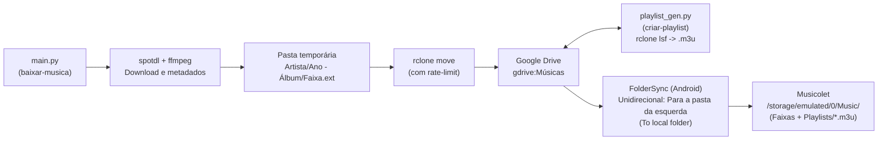

# Music Fetcher

Suíte CLI em Python (compatível com **Arch Linux** e **Windows**) para baixar, organizar com metadados, gerar playlists `.m3u` interativas direto da nuvem e sincronizar uma biblioteca musical offline (~29,3 GiB / ~3.360 faixas) entre o PC, o **Google Drive** e um smartphone **Android** (**FolderSync** + **Musicolet**).

---

## Arquitetura do Fluxo



---

## Instalação Rápida (1 comando)

### 1. Pré-requisitos

- **Arch Linux:**
  ```bash
  sudo pacman -S --needed python ffmpeg rclone
  ```
- **Windows (PowerShell):**
  ```powershell
  winget install Python.Python.3.12 Gyan.FFmpeg Rclone.Rclone
  ```
  *(Reinicie o terminal após instalar pelo `winget`.)*

- **Conectar o Google Drive no `rclone` (apenas 1 vez):**
  ```bash
  rclone config
  ```
  Crie um remote chamado `gdrive` do tipo **Google Drive** (`drive`) e conclua o login OAuth no navegador.

### 2. Clonar e instalar

- **Arch Linux / Linux:**
  ```bash
  git clone https://github.com/Igor182/music-fetcher.git
  cd music-fetcher
  ./install.sh
  ```
  O `install.sh` cria a `.venv`, instala o `requirements.txt` e registra automaticamente os comandos `baixar-musica` e `criar-playlist` no seu `~/.bashrc` / `~/.zshrc`. Basta recarregar o shell (`source ~/.bashrc` ou `source ~/.zshrc`).

- **Windows (PowerShell):**
  ```powershell
  git clone https://github.com/Igor182/music-fetcher.git
  cd music-fetcher
  .\install.ps1
  ```
  O `install.ps1` cria a `.venv`, instala o `requirements.txt` e registra automaticamente a pasta no `PATH` do usuário para você usar `baixar-musica` e `criar-playlist` em qualquer terminal (PowerShell, CMD ou `Win + R`).

  > Se o PowerShell bloquear a execução de scripts, rode uma vez:
  > `Set-ExecutionPolicy -Scope CurrentUser RemoteSigned`

---

## Como Usar

Depois de instalar, basta digitar de qualquer pasta:

### 1. Baixar músicas e sincronizar (`baixar-musica` / `main.py`)

```bash
baixar-musica
```

Digite o nome da música, álbum, playlist ou cole um link do Spotify/YouTube. O `main.py`:
1. Baixa via `spotdl` + `ffmpeg` embutindo capa e metadados na estrutura `Artista/Ano - Álbum/Número - Título.ext`.
2. Move automaticamente para `gdrive:Músicas` usando `rclone move` com flags de rate-limit e limpa a pasta temporária local.

---

### 2. Gerar playlists interativas na nuvem (`criar-playlist` / `playlist_gen.py`)

```bash
criar-playlist
```

O `playlist_gen.py` consulta toda a biblioteca diretamente no Google Drive via `rclone lsf gdrive:Músicas -R --files-only` (**sem baixar nenhum arquivo de áudio localmente**) e solicita interativamente:

1. **Nome da playlist** (ex: `Rock Anos 90` -> gera `Rock Anos 90.m3u`).
2. **Filtros opcionais** *(deixe em branco e aperte Enter para ignorar qualquer filtro)*:
   - **Intervalo de anos ou ano específico**: ex. `1990-1999` ou `2005`, extraído dos 4 primeiros dígitos da pasta do álbum (`Artista/Ano - Álbum/`).
   - **Múltiplos artistas separados por vírgula**: ex. `Nirvana, Pearl Jam, Radiohead` (busca parcial *case-insensitive* na pasta do artista).
   - **Formato de áudio específico**: `flac`, `m4a`, `mp3`, `ogg` ou `opus` (ou todos os formatos se deixado em branco).

#### Como funcionam os caminhos relativos (`../`) no `.m3u`

As playlists geradas são enviadas para `gdrive:Músicas/Playlists/` com cabeçalho `#EXTM3U`, quebras de linha LF (`\n`) e caminhos relativos partindo da subpasta `Playlists/`:

```m3u
#EXTM3U
../Nirvana/1991 - Nevermind/01 - Smells Like Teen Spirit.m4a
../Pearl Jam/1991 - Ten/03 - Alive.m4a
```

Quando o **FolderSync** sincroniza `/Músicas` para `/storage/emulated/0/Music/`, a estrutura no Android fica:

```text
/storage/emulated/0/Music/
├── Nirvana/1991 - Nevermind/01 - Smells Like Teen Spirit.m4a
├── Pearl Jam/1991 - Ten/03 - Alive.m4a
└── Playlists/
    └── Rock Anos 90.m3u   (usa ../ para voltar a /Music/)
```

Assim, o **Musicolet** importa os arquivos `.m3u` automaticamente sem depender de caminhos absolutos do dispositivo.

---

## Configuração Manual de Aliases (opcional)

Caso prefira configurar manualmente sem rodar o `install.sh`:

**Arch Linux (`~/.bashrc` ou `~/.zshrc`):**

```bash
alias baixar-musica='~/projetos/music-fetcher/.venv/bin/python ~/projetos/music-fetcher/main.py'
alias criar-playlist='python ~/projetos/music-fetcher/playlist_gen.py'
```

*(O `playlist_gen.py` usa apenas a biblioteca padrão do Python + `rclone`, então roda tanto com o `python` do sistema quanto com o da `.venv`.)*

---

## Configuração (`config.json`)

| Chave | Valor padrão | Descrição |
| --- | --- | --- |
| `rclone_remote` | `"gdrive:Músicas"` | Destino remoto no `rclone` (usado por `main.py` e `playlist_gen.py`). |
| `temp_dir` | `null` | Pasta temporária para downloads. Com `null`, usa automaticamente o diretório temporário do sistema (`/tmp/music-fetcher-downloads` no Linux ou `%TEMP%\music-fetcher-downloads` no Windows). |
| `audio_format` | `"m4a"` | Formato de áudio de saída (`m4a`, `flac`, `mp3`, `opus`, etc.). |
| `audio_bitrate` | `"256k"` | Taxa de bits do áudio (`128k`, `256k`, `320k`, `auto`). |
| `output_template` | `"{artist}/{year} - {album}/{track-number} - {title}.{output-ext}"` | Estrutura de pastas e nome de arquivo usada pelo `spotdl`. |
| `download_threads` | `4` | Número de threads simultâneas no `spotdl`. |
| `rclone_transfers` | `3` | Transferências paralelas do `rclone`. |
| `rclone_checkers` | `4` | Verificadores paralelos do `rclone`. |
| `rclone_tpslimit` | `2` | Limite de requisições por segundo à API do Google Drive. |
| `rclone_retries` | `5` | Tentativas automáticas em caso de erro temporário. |

---

## Estrutura do Projeto

| Arquivo | Função |
| --- | --- |
| `main.py` | CLI interativa de download (`spotdl`) e envio automático para o Drive (`rclone move`). |
| `playlist_gen.py` | CLI interativa geradora de playlists `.m3u` direto da nuvem (`rclone lsf`). |
| `config.json` | Configurações de remote, áudio, template de pastas e rate-limit do `rclone`. |
| `requirements.txt` | Dependência Python (`spotdl`). |
| `install.sh` | Instalador automático para Arch Linux / Linux (cria `.venv`, instala deps e configura aliases). |
| `install.ps1` | Instalador automático para Windows (cria `.venv`, instala deps e registra comandos no `PATH`). |
| `baixar-musica.cmd` | Wrapper Windows para o `main.py`. |
| `criar-playlist.cmd` | Wrapper Windows para o `playlist_gen.py`. |

---

## Sincronização Manual em Lote com `rclone` (Evitando Rate Limit)

Para mover uma pasta local inteira de músicas para o Google Drive (como em migrações grandes de biblioteca), use as flags ajustadas empiricamente para evitar erros `403 RATE_LIMIT_EXCEEDED` da API do Google Drive:

**Arch Linux:**

```bash
rclone move ~/Desktop/Music gdrive:Músicas \
  --delete-empty-src-dirs \
  --transfers 3 \
  --checkers 4 \
  --tpslimit 2 \
  --retries 5 \
  --log-level ERROR \
  --progress
```

**Windows (PowerShell):**

```powershell
rclone move "$HOME\Desktop\Music" gdrive:Músicas `
  --delete-empty-src-dirs `
  --transfers 3 `
  --checkers 4 `
  --tpslimit 2 `
  --retries 5 `
  --log-level ERROR `
  --progress
```

- **`--tpslimit 2`**: Limita a 2 transações por segundo na API do Google Drive, evitando bloqueios `403 RATE_LIMIT_EXCEEDED`.
- **`--transfers 3`** e **`--checkers 4`**: Mantém throughput estável sem estourar a cota de requisições simultâneas.
- **`--retries 5`**: Reenvia automaticamente em caso de oscilação de rede ou throttling pontual.
- **`--delete-empty-src-dirs`**: Remove diretórios locais vazios após mover as faixas.

---

## Sincronização no Android (FolderSync + Musicolet)

1. **FolderSync**:
   - Conecte a conta do Google Drive e crie um par de pastas (*Folderpair*):
     - **Pasta remota**: `/Músicas`
     - **Pasta local**: `/storage/emulated/0/Music/`
     - **Tipo de sincronização**: **Unidirecional -> Para a pasta da esquerda (*To local folder*)**
     - Desative a exclusão de arquivos locais/remotos e pule arquivos já existentes para baixar apenas músicas novas e `.m3u` atualizados.
2. **Musicolet**:
   - Aponte a biblioteca para `/storage/emulated/0/Music/`.
   - As playlists em `/storage/emulated/0/Music/Playlists/*.m3u` podem ser importadas diretamente, com os caminhos relativos `../` já apontando para as faixas corretas.
